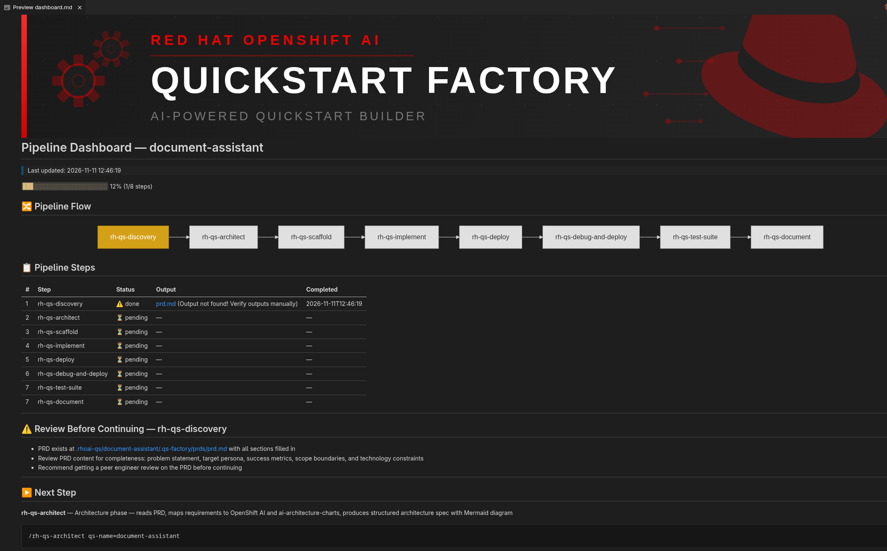

# Quickstart Factory

An AI-powered tool for managing the full lifecycle of [Red Hat AI Quickstarts](https://docs.redhat.com/en/learn/ai-quickstarts) — from idea to published quickstart.

Ready to use after cloning with the prerequisites below. Engineers review key decisions and outputs throughout the process.

> **Status: Skills and workflows are being refined.**

## What it does

Quickstart Factory equips your AI coding assistant (Claude, Cursor, Gemini, or Codex) with skills to:

- **Build new quickstarts** — turn an idea into requirements and architecture, write application code, tests, and Helm charts, then deploy to OpenShift. Agents scan resource health, debug and fix failures, and verify end-to-end behavior before preparing CI, documentation, and a publication PR.
- **Maintain existing quickstarts** — deploy and debug existing source code, upgrade dependencies, migrate storage, and expand CI coverage. Extract reusable patterns from completed quickstarts to enrich the shared knowledge base for future designs and implementations.

## Getting started

### Prerequisites

- Git and Python 3.10+ with PyYAML (used by the pipeline dashboard)
- [`gh` CLI](https://cli.github.com/) installed and authenticated (`gh auth status`)
- Bash, `jq`, and `yq` for the cluster policy hook
- An AI coding client: [Claude Code](https://docs.anthropic.com/en/docs/claude-code), [Cursor](https://cursor.sh), [Gemini Code Assist](https://cloud.google.com/gemini/docs/codeassist/overview), or [Codex](https://openai.com/index/codex/)

Building and deploying also require the quickstart's tools (such as Make, Helm, and Podman) and OpenShift access. The deployment skill checks cluster access before proceeding.

### Setup

1. Clone the repository:

```bash
git clone https://github.com/rh-ai-quickstart/quickstart-factory.git
cd quickstart-factory
```

2. Open the cloned directory using your AI client's usual launch method. For example:

```bash
claude                       # Claude Code
```

Skills and client configuration are included in the clone — no manual skill installation or initial sync needed. Follow [Build or resume a quickstart](#build-or-resume-a-quickstart) to start discovery.

> **Quickstart location:** New quickstarts are created under `.rhoai-qs/<slug>/`, relative to the factory root. For an existing quickstart, clone or copy its source into that location (symlinks are not recommended: some AI clients treat their targets as external files and repeatedly ask permission to read or write them). Application code lives at this repo root; PRDs, designs, and pipeline records live in its `.qs-factory/` directory.

> **Temporary files:** `.tmp/<slug>/` at the factory root holds internal working files and debug logs. It is gitignored and outside the quickstart repo, so these files are not committed to either repository.

## How it works

Each skill covers part of the lifecycle. A main agent coordinates specialists with focused context and independent reviewers. Written specs, acceptance criteria, reasoning guardrails, and limited fix-and-recheck loops guide their work.

Engineers approve requirements, architecture, and implementation specs. Skills reuse a knowledge base and Helm charts from [ai-architecture-charts](https://github.com/rh-ai-quickstart/ai-architecture-charts).

### Main pipeline

Follow this sequence to build a new quickstart:

| Step | Skill | Result |
|------|-------|--------|
| 1 | `rh-qs-discovery` | Validated product requirements document (PRD) and local template repo |
| 2 | `rh-qs-architect` | Architecture spec, component choices, and diagram |
| 3 | `rh-qs-implement` | Repository setup, application code, interface contracts, tests, and Helm charts |
| 4 | `rh-qs-debug-and-deploy` | Working OpenShift app after health scans, automatic fixes, and end-to-end tests |
| 5 | `rh-qs-test-suite` | CI workflows for checks, E2E tests, evaluations, image publishing, and nightly runs |
| 6 | `rh-qs-document` | Quickstart README with requirements, architecture, and deployment instructions based on the verified deployment |
| 7 | `rh-qs-ship` | Publication PR, blog draft, and backlog update |

Shipping removes internal `.qs-factory/` records from the finished quickstart. Review the PR and blog draft before publication.

### Build or resume a quickstart

**Start each skill in a new chat.** It reads the PRD, specs, and handoff manifests saved under `.rhoai-qs/<slug>/.qs-factory/` to get context from previous stages.

Start the chats from the factory root.

1. Run `/rh-qs-discovery` and describe your idea or supply a document, such as a plan for a document Q&A assistant.
2. Discovery generates the lowercase, hyphenated name (the **slug**) and initializes a local repo from [ai-quickstart-template](https://github.com/rh-ai-quickstart/ai-quickstart-template). Answer its questions and approve the PRD, then follow its instructions to create the GitHub repo and push the local work. Next, run `/rh-qs-architect qs-name=document-assistant`, using the slug discovery generated.
3. Approve the architecture, then run `/rh-qs-implement qs-name=document-assistant`. Review its implementation spec before coding begins, and continue through the remaining pipeline stages, reviewing each output before handoff.
4. When returning to work, open the dashboard and copy the **Next Step** command into a new chat. Commands use `/<skill-name> qs-name=<slug>`, for example `/rh-qs-implement qs-name=document-assistant`.

### Track progress in the dashboard

At the end of each skill, the agent provides a link to `.rhoai-qs/<slug>/.qs-factory/flow/dashboard.md`. Follow it to view pipeline progress in a Markdown preview with Mermaid support.

It shows the flow, progress, output links, **Review Before Continuing** guidance, and the next command. Use it to review completed work and pick up where you left off. Check linked artifacts and validation results before continuing; warnings indicate outputs that were not found automatically and must be checked manually.




## Skills

For an existing quickstart, first clone its repo into `.rhoai-qs/<slug>/` under the factory root. Then start a new chat and invoke a skill with the same slug. For example: `/rh-qs-debug-and-deploy qs-name=document-assistant`.

| Skill | What it does |
|-------|-------------|
| **rh-qs-debug-and-deploy** | Deploy existing quickstart source, scan health and fix resource failures, then run E2E tests and fix failures, with limited retries in each phase. |
| **rh-qs-test-suite** | Expand or refresh CI checks, E2E tests, evaluations, and nightly runs. |
| **rh-qs-secure** | Security guidance during architecture, implementation, and deployment. |
| **rh-qs-bump-versions / rh-qs-minio-conversion** | Update dependencies or migrate MinIO to S4-backed `aws-compatible-storage`. |
| **qs-extract-knowledge** | Extract reusable patterns from completed quickstarts and enrich the shared knowledge base. |
| **validate-skill** | Run Factory skills against fixtures and compare their output with expected repositories. |

<details>
<summary>Backlog tools and CLI usage</summary>

Say **"hello"** or run `/rh-qs-session-start` for backlog browsing, issue creation, grooming, gap analysis, and blog drafts. See the [walkthrough with screenshots](screenshots/README.md).


You can also run the scripts directly:

```bash
# Backlog summary
python3 core/skills/gh-backlog-reader/scripts/read_backlog.py --summary

# Single issue with comments and linked repos
python3 core/skills/gh-backlog-reader/scripts/read_backlog.py --issue 39

# Issues by a specific author
python3 core/skills/gh-backlog-reader/scripts/read_backlog.py --author ccamacho

# Search for topics
python3 core/skills/gh-backlog-reader/scripts/read_backlog.py --search "Financial Services"

# Filter by label
python3 core/skills/gh-backlog-reader/scripts/read_backlog.py --label Acknowledged

# Create an issue (dry-run first)
python3 core/skills/gh-issue-creator/scripts/create_issues.py \
  --name "GraphRAG" \
  --technology "Llama Stack" \
  --dry-run
```

</details>

## Resources

- **Backlog:** https://github.com/rh-ai-quickstart/ai-quickstart-contrib/issues
- **Quickstart template:** https://github.com/rh-ai-quickstart/ai-quickstart-template
- **Quickstart catalog:** https://docs.redhat.com/en/learn/ai-quickstarts
- **GitHub org:** https://github.com/rh-ai-quickstart

## Project structure

```
AGENTS.md               ← AI agent guidelines (read by all clients)
CLAUDE.md               ← Imports AGENTS.md (for Claude Code)
GEMINI.md               ← Symlink → AGENTS.md (for Gemini)
core/
  skills/               ← Pipeline, backlog, and maintenance skills + knowledge base
  flow/                 ← Pipeline registry and dashboard checkpoint script
  oc-policy-gate/       ← Namespace and operation policy hook
  scripts/
    sync-clients.sh     ← Sync skills to AI clients
docs/                   ← Design records and conventions
.rhoai-qs/<slug>/        ← Quickstart's own Git repo (gitignored by the factory, tracked by the quickstart)
  .qs-factory/          ← PRD, designs, specs, manifests, dashboard, and reports
  chart/, packages/     ← Quickstart application and deployment code
.tmp/<slug>/            ← Temporary internal files and debug logs (gitignored)
.blog-drafts/           ← Announcement drafts (gitignored)
.reports/               ← Cross-quickstart reports (gitignored)
```

Each quickstart has its own remote and history. Its `.qs-factory/` records are tracked for team review during development. See the [file layout convention](docs/foundation/pipeline-convention.md).

## Multi-client support

Skills and the project instructions in `AGENTS.md` are available across Claude Code, Cursor, Gemini, and Codex.

Skills are committed as relative symlinks in each client's directory. Run `bash core/scripts/sync-clients.sh` to regenerate after adding new skills.

### Cluster access with oc-policy-gate

The [oc-policy-gate](https://github.com/rh-ai-quickstart/oc-policy-gate) hooks let agents deploy, inspect, debug, and fix quickstarts within namespace and operation limits. Permitted commands run without repeated approval prompts; other commands are blocked or require approval according to the policy.

| Client | Cluster policy hooks |
|--------|----------------------|
| Claude Code | Included and configured in the clone |
| Codex CLI | Included and configured in the clone |

No manual hook installation is needed. To customize permitted namespaces and operations (such as read, write, or exec), edit the policy files linked under `.claude/hooks/` or `.codex/hooks/`. See the [policy guide](https://github.com/rh-ai-quickstart/oc-policy-gate) for configuration details.

## License

Licensed under Apache License 2.0. See [`LICENSE`](./LICENSE).
